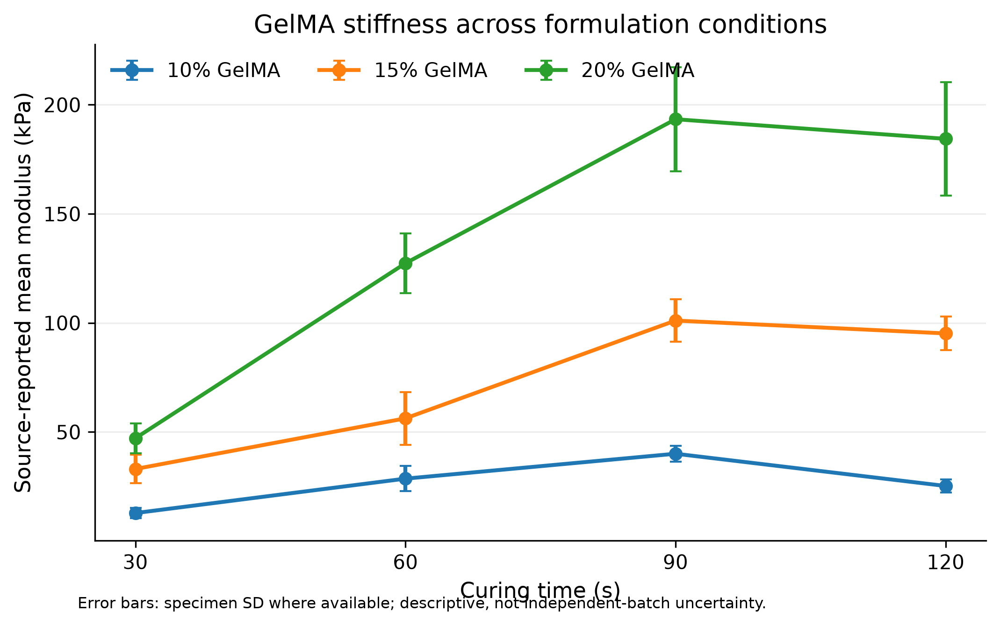
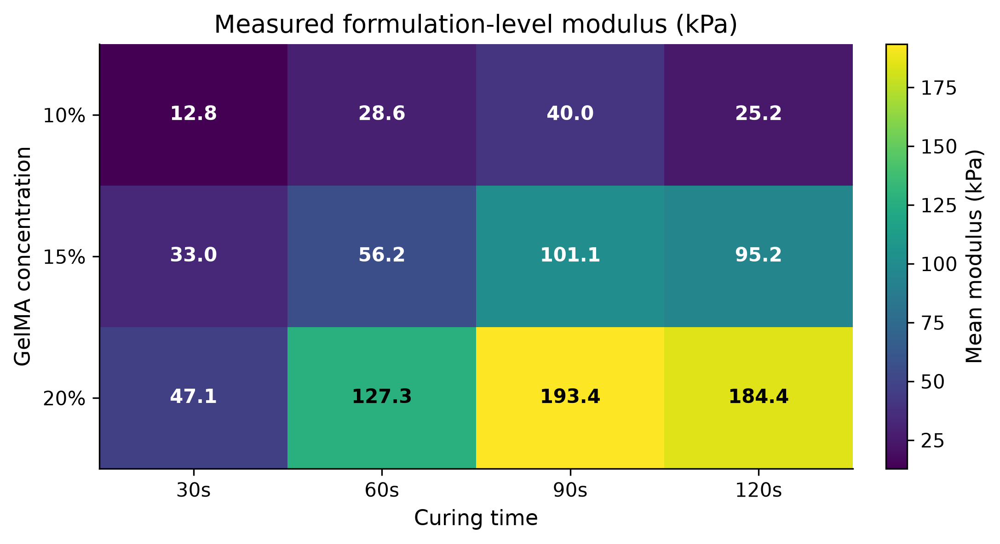
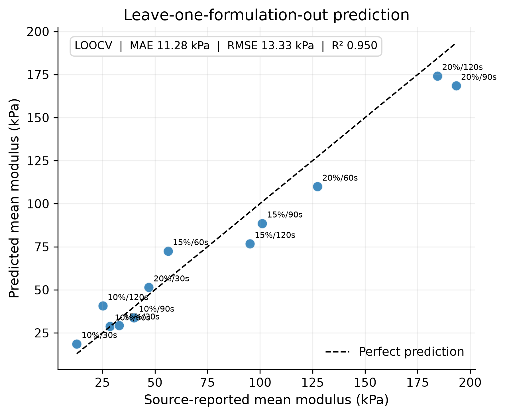
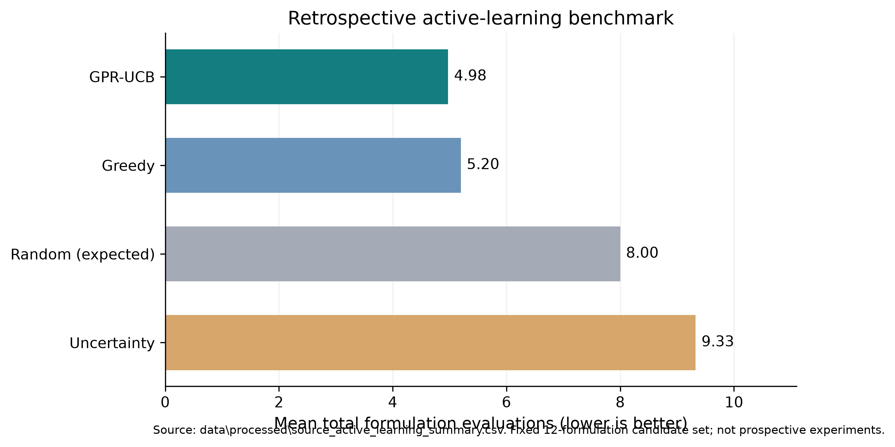

# Hydrogel Intelligence

### Machine Learning-Guided Prediction and Retrospective Active-Learning Optimization of GelMA Hydrogel Mechanical Properties

**An independent computational materials research project**

**Researcher:** Ebenezer Ayaaba  
**Background:** BSc Materials Engineering | Systems & Data Engineering  
**Research Areas:** Materials Informatics · Polymer Mechanics · Biomaterials · Machine Learning · Active Learning

[](https://www.python.org/)
[](https://scikit-learn.org/)
[](https://github.com/Ayarich/Hydrogel-Intelligence)
[](https://github.com/Ayarich/Hydrogel-Intelligence)

**[Research Code](https://github.com/Ayarich/Hydrogel-Intelligence)** · **[Reproducibility Guide](docs/REPRODUCIBILITY.md)** · **[Scientific Figures](reports/figures/)** · **[Research Portfolio](https://ebenezerayaaba.vercel.app/)**

---

## 01. Research Abstract

Hydrogel mechanical properties are influenced by formulation composition and manufacturing conditions, making systematic material optimization an important challenge in biomaterials engineering.

This project investigates the use of **machine learning and active-learning methods to model and explore the compressive mechanical properties of gelatin methacryloyl (GelMA) hydrogels**.

Using publicly available experimental characterization data, the study combines compression-data analysis, Young's modulus reproducibility assessment, formulation-level predictive modeling, Gaussian Process Regression (GPR), and retrospective experiment-selection simulations.

The analysis considers **144 specimen-level modulus measurements across 12 unique GelMA formulations**, defined by polymer concentration and curing time.

A log-transformed quadratic Ridge regression model achieved a leave-one-formulation-out cross-validation (LOOCV) R² of **0.950** and an RMSE of **13.330 kPa**.

In a retrospective search benchmark, a Gaussian Process Upper Confidence Bound (GPR-UCB) strategy required a mean of **4.976 total formulation evaluations**, compared with **8.000 under random selection**, corresponding to approximately **37.8% fewer total evaluations**.

These results demonstrate a promising computational workflow for exploring small experimental materials datasets. They do not establish prospective optimization performance or generalization beyond the investigated formulation domain.

---

## 02. Research at a Glance

| Research indicator | Result |
|:---|---:|
| Experimental specimens | 144 |
| Unique GelMA formulations | 12 |
| GelMA concentrations | 10%, 15%, 20% |
| Curing times | 30, 60, 90, 120 s |
| Modulus calculations reproduced within 0.01 kPa | 140 / 144 |
| Best evaluated point-prediction model | Log-target Quadratic Ridge |
| Formulation-level LOOCV R² | 0.950 |
| Formulation-level LOOCV MAE | 11.277 kPa |
| Formulation-level LOOCV RMSE | 13.330 kPa |
| Highest observed mean modulus | 193.382 kPa |
| Highest-stiffness measured formulation | 20% GelMA, 90 s |
| Best retrospective experiment-selection strategy | GPR-UCB |
| Mean evaluations: GPR-UCB | 4.976 |
| Mean evaluations: random selection | 8.000 |

> **Research interpretation:** The measured 20% GelMA, 90-second formulation exhibited the highest mean modulus within the 12 tested conditions. This is not evidence of a globally optimal formulation or suitability for every biomedical application.

---

## 03. Scientific Motivation

Hydrogels are hydrated polymer networks whose mechanical properties can be important for tissue engineering, bioprinting, drug delivery, and other biomaterials applications.

In photocrosslinked GelMA systems, polymer concentration and curing conditions can influence network formation and mechanical response.

Conventional formulation optimization may require repeated material preparation and mechanical testing. Data-driven approaches offer a way to learn from existing experiments and prioritize informative future measurements.

The central research question is:

**Can machine-learning models predict GelMA compressive stiffness from formulation parameters, and can uncertainty-aware experimental selection reduce the number of evaluations required to identify high-stiffness formulations within an existing experimental design?**

This project investigates that question using a retrospective computational workflow.

### Research Objectives

1. Reproduce source-reported Young's modulus values from experimental compression measurements.
2. Quantify how GelMA concentration and curing time relate to measured compressive stiffness.
3. Compare regression methods for predicting formulation-level mean modulus.
4. Investigate Gaussian Process Regression and uncertainty-aware prediction.
5. Evaluate retrospective acquisition strategies against greedy, uncertainty-only, and random selection.
6. Establish a reproducible foundation for future independent experimental validation.

---

## 04. Experimental Data and Provenance

### Data Source

The experimental measurements used in this repository were **not collected by the project author**. They originate from the publicly available *Hydrogel Characterization Data* dataset.

**Original dataset:** [Hydrogel Characterization Data — Mendeley Data](https://doi.org/10.17632/cx8cfgrhnn.1)

The original source is credited for the experimental measurements. The independent contribution of this repository consists of data processing, computational reproducibility analysis, machine-learning evaluation, retrospective experiment-selection comparisons, and research visualization.

### GelMA Experimental Design

| Parameter | Values |
|:---|:---|
| Material | Gelatin methacryloyl (GelMA) |
| Concentration | 10%, 15%, 20% |
| Curing duration | 30, 60, 90, 120 seconds |
| Unique formulation conditions | 12 |
| Specimens per formulation | 12 |
| Total specimen-level records | 144 |
| Primary modeled response | Source-reported mean Young's modulus (kPa) |

The repository also preserves PEGDA characterization and compression workbooks from the source dataset. The primary predictive-model and active-learning findings presented here concern **GelMA formulations**, not a combined GelMA–PEGDA predictive model.

### Primary Data Files

- `data/processed/gelma_source_specimens.csv` — source-reported specimen-level moduli.
- `data/processed/gelma_source_formulations.csv` — formulation-level mean and standard-deviation summaries.
- `data/processed/gelma_through_origin_validation.csv` — modulus reproduction audit.
- `data/processed/source_loocv_predictions.csv` — formulation-level held-out predictions.
- `data/processed/source_model_metrics.csv` — regression evaluation results.
- `data/processed/source_active_learning_summary.csv` — retrospective experiment-selection summary.

The source-reported formulation means are the authoritative modeling targets. Independently recalculated modulus values are retained for reproducibility assessment rather than silently substituted for source measurements.

---

## 05. Research Workflow

The study follows five computational stages:

**Experimental compression data**  
↓  
**Mechanical-property extraction and reproducibility audit**  
↓  
**Formulation-level dataset construction**  
↓  
**Machine-learning model development and cross-validation**  
↓  
**Gaussian Process active-learning simulation and evaluation**

Each stage is documented through the repository's notebooks, processed datasets, scripts, and reports.

---

## 06. Mechanical Characterization and Reproducibility

Young's modulus was investigated using stress–strain relationships obtained from compression-test files.

For a linear approximation:

\[
\sigma = E\varepsilon
\]

where:

- \(\sigma\) is compressive stress in pascals.
- \(\varepsilon\) is dimensionless compressive strain.
- \(E\) is the fitted modulus in pascals.

The analysis examined the sensitivity of calculated moduli to regression configuration and strain-window selection.

### Reproduction of Source Values

The original characterization workbook specifies different strain intervals:

- **1–6% strain:** most GelMA conditions.
- **1–3% strain:** 20% GelMA cured for 90 and 120 seconds.

Using through-origin linear regression within the documented windows reproduced **140 of 144 reported specimen modulus values within 0.01 kPa**.

Four specimens retained discrepancies. These are preserved in the reproducibility records and require further investigation into specimen-specific processing or fitting conventions.

This audit illustrates an important aspect of scientific computing: obtaining a numerical result is not equivalent to establishing that the complete experimental processing procedure has been reproduced.

---

## 07. Formulation–Property Relationships

### GelMA Concentration and Curing Time

The observed formulation means reveal substantial variation in compressive stiffness across concentration and curing conditions.



**Figure 1.** Source-reported mean GelMA modulus across curing durations for the investigated polymer concentrations. Error bars show specimen-level variability.

The measured responses are not uniformly increasing with curing time. Some formulations exhibit lower mean modulus at 120 seconds than at 90 seconds.

This behavior suggests that stiffness should be characterized across the investigated formulation domain rather than assumed to increase monotonically with exposure duration.

### Formulation–Property Heatmap



**Figure 2.** Heatmap of mean modulus across the 12 measured GelMA concentration–curing-time combinations.

The largest observed mean stiffness was:

**193.382 kPa at 20% GelMA and 90 seconds curing.**

This observation defines the best measured condition for the specific objective of maximizing mean modulus among the tested formulations. Other application objectives may favor different mechanical properties.

---

## 08. Machine-Learning Methodology

### Input Variables

Two formulation parameters were used as predictive features:

\[
X =
\begin{bmatrix}
\text{GelMA concentration (\%)} \\
\text{Curing time (s)}
\end{bmatrix}
\]

The prediction target was formulation-level mean modulus:

\[
y = E_{\text{mean}} \; (\text{kPa})
\]

Although the dataset includes 144 specimen records, the predictive task contains **12 unique formulation-level observations**.

Specimens from the same formulation are not treated as 144 distinct formulation conditions.

### Modeling Approaches

The modeling investigation included:

- Mean-response baseline.
- Linear regression.
- Polynomial Ridge regression.
- Log-transformed target regression.
- Gaussian Process Regression.

The best-performing evaluated point-prediction configuration used quadratic polynomial features, standardized input variables, Ridge regularization, and a logarithmically transformed modulus target.

### Cross-Validation Strategy

Model performance was assessed using **leave-one-formulation-out cross-validation (LOOCV)**.

For each held-out formulation:

1. The predictive model was fitted using the remaining 11 formulation means.
2. The held-out formulation's modulus was predicted.
3. Predictions were aggregated across all 12 held-out conditions.
4. MAE, RMSE, and R² were calculated from the out-of-fold predictions.

This approach avoids placing specimen replicates from the same formulation on both sides of a train–test split.

However, it does not eliminate optimism arising from model and hyperparameter exploration on the same small dataset.

### Predictive Performance

| Model | MAE (kPa) | RMSE (kPa) | LOOCV R² |
|:---|---:|---:|---:|
| Mean baseline | 55.973 | 64.732 | -0.190 |
| Log-target Quadratic Ridge | **11.277** | **13.330** | **0.950** |



**Figure 3.** Observed and leave-one-formulation-out predicted mean modulus values for the selected regression model.

The selected model substantially improved predictive accuracy relative to the mean-response baseline on this dataset.

**Interpretation:** The results support the feasibility of learning relationships between the two investigated formulation parameters and stiffness within the measured experimental domain. Independent formulations or experimental batches are needed to establish generalization more convincingly.

---

## 09. Gaussian Process Regression and Active Learning

Prediction alone does not determine which formulation should be evaluated next.

To investigate sequential experiment selection, the project assessed Gaussian Process Regression as a surrogate model for balancing predicted stiffness and predictive uncertainty.

A simplified Upper Confidence Bound acquisition function is:

\[
a(x)=\mu(x)+\beta^{1/2}\sigma(x)
\]

where:

- \(\mu(x)\) is predicted response in the model's target space.
- \(\sigma(x)\) represents predictive uncertainty.
- \(\beta\) controls the exploration–exploitation tradeoff.

The retrospective implementation operates on a logarithmic modulus target, so acquisition values should not be interpreted directly as modulus values in kPa.

### Acquisition Strategies

Four selection strategies were considered:

| Strategy | Selection principle |
|:---|:---|
| GPR-UCB | Balance predicted performance and uncertainty |
| Greedy | Select the highest predicted performance |
| Uncertainty-only | Select the most uncertain candidate |
| Random | Select an untested candidate at random |

### Retrospective Benchmark Design

The benchmark used the 12 measured formulation conditions as a finite candidate pool.

It evaluated **165 possible three-formulation initial sets excluding the known highest-stiffness condition**.

Each sequential policy then selected additional candidate formulations until it encountered the highest observed mean modulus.

The benchmark compares strategies under the recorded historical responses; it is **not a physical laboratory campaign**.

### Experiment-Selection Results

| Strategy | Mean total evaluations | Median | Success by 5 | Success by 6 |
|:---|---:|---:|---:|---:|
| **GPR-UCB** | **4.976** | 5 | 72.1% | 88.5% |
| Greedy | 5.200 | 5 | 62.4% | 83.6% |
| Random (expected) | 8.000 | 8 | 22.2% | 33.3% |
| Uncertainty-only | 9.327 | 10 | 6.1% | 6.1% |



**Figure 4.** Comparison of retrospective experiment-selection strategies based on the mean number of formulation evaluations required to identify the highest-stiffness measured condition.

### Relative Reduction in Evaluations

Compared with random selection:

\[
\text{Reduction} =
\frac{8.000-4.976}{8.000}\times100
\]

\[
\boxed{37.8\%}
\]

The simulated GPR-UCB policy required approximately **37.8% fewer total formulation evaluations** than the expected random-search baseline.

With three initial formulations already observed, this corresponds to approximately 1.976 additional selections for GPR-UCB compared with 5.000 additional selections for random search.

**Important distinction:** These results measure retrospective search efficiency for identifying the known maximum within a fixed candidate set. They do not establish a reduction in real-world laboratory cost, a globally optimal hydrogel formulation, or prospective active-learning success.

---

## 10. Reproducibility

The project provides a Python workflow for regenerating the source-derived modeling and visualization results.

### Requirements

- Python 3.12 or a compatible Python version.
- NumPy.
- pandas.
- SciPy through scikit-learn.
- scikit-learn.
- Matplotlib.
- openpyxl.

### Environment Setup

Clone the repository:

```bash
git clone https://github.com/Ayarich/Hydrogel-Intelligence.git
cd Hydrogel-Intelligence
```

Create a virtual environment:

```bash
python -m venv .venv
```

Activate it on Windows PowerShell:

```powershell
.\.venv\Scripts\Activate.ps1
```

Install the required packages:

```bash
python -m pip install -r requirements.txt
```

### Run the Analysis

The reproduction script expects the original GelMA characterization workbook under `data/raw/`.

If necessary, create that directory and copy the source workbook:

```powershell
New-Item -ItemType Directory -Force data\raw | Out-Null
Copy-Item GelMA_Characterization_Data.xlsx data\raw\
```

Then execute:

```bash
python src/reproduce.py
python src/figures.py
```

The scripts generate the source-based modeling results and the primary scientific visualizations.

### Output Files

**Processed results**

- `data/processed/source_model_metrics.csv`
- `data/processed/source_loocv_predictions.csv`
- `data/processed/source_active_learning_runs.csv`
- `data/processed/source_active_learning_summary.csv`

**Scientific figures**

- `reports/figures/01_formulation_stiffness.png`
- `reports/figures/02_formulation_heatmap.png`
- `reports/figures/03_loocv_predictions.png`
- `reports/figures/04_active_learning_benchmark.png`

PDF versions of the figures are also provided for scientific reporting.

For further information, consult the [Reproducibility Guide](docs/REPRODUCIBILITY.md).

---

## 11. Repository Organization

```text
Hydrogel-Intelligence/
│
├── README.md
├── requirements.txt
├── .gitignore
│
├── data/
│   ├── raw/
│   └── processed/
│       ├── gelma_source_specimens.csv
│       ├── gelma_source_formulations.csv
│       ├── source_model_metrics.csv
│       ├── source_loocv_predictions.csv
│       └── source_active_learning_summary.csv
│
├── notebooks/
│   ├── 01_Hydrogel_Experimental_Analysis.ipynb
│   └── 02_Hydrogel_Machine_Learning.ipynb
│
├── src/
│   ├── reproduce.py
│   └── figures.py
│
├── reports/
│   ├── figures/
│   ├── final_active_learning_summary.csv
│   └── research_metadata.json
│
├── docs/
│   └── REPRODUCIBILITY.md
│
├── GelMA_CompressionFiles/
├── PEGDA_CompressionFiles/
│
├── GelMA_Characterization_Data.xlsx
└── PEGDA_Characterization_Data.xlsx
```

The structure distinguishes experimental source material, processed data, exploratory notebooks, reusable scripts, and derived research outputs.

---

## 12. Scientific Limitations

This is an exploratory computational research study. The following limitations are important when interpreting the results.

**Limited formulation diversity.** Only 12 unique GelMA formulations were available. The specimen-level count does not increase the number of unique input conditions.

**Model-selection uncertainty.** Several modeling choices were investigated using the same dataset. Reported cross-validation performance should therefore be treated as exploratory rather than as a fully independent assessment.

**Unverified batch independence.** The independence of manufactured specimens and experimental batches requires additional source-level verification.

**Residual modulus discrepancies.** Four specimen values were not reproduced within the selected numerical tolerance and are retained in the audit.

**Predictive uncertainty.** Gaussian Process uncertainty estimates were sensitive to modeling assumptions. Nominal uncertainty intervals should not be assumed to be well calibrated outside the available data.

**Retrospective optimization.** The acquisition strategies were assessed using historical measurements rather than experiments selected and conducted prospectively.

**Single-property objective.** Maximizing compressive stiffness alone does not establish suitability for tissue engineering, printing performance, biological compatibility, or other target applications.

These limitations guide the next stage of research rather than invalidate the computational findings.

---

## 13. Future Research Directions

### Independent Experimental Validation

Test additional GelMA formulations, ideally with independently manufactured batches and consistent mechanical testing protocols.

### Expanded Formulation Space

Investigate additional material and manufacturing variables, such as photoinitiator concentration, exposure intensity, formulation composition, and processing conditions when reliable measurements are available.

### Improved Uncertainty Quantification

Evaluate Gaussian Process calibration using independent validation data, alternative kernels, and more explicit treatment of experimental variability.

### Multi-Objective Materials Optimization

Extend prediction beyond stiffness to application-relevant characteristics, potentially including swelling, degradation, printability, and biological performance where measured data are available.

### Closed-Loop Experimental Design

Develop a workflow that proposes candidate formulations, incorporates newly acquired measurements, retrains the surrogate model, and evaluates whether sequential recommendations improve experimental efficiency.

The longer-term research vision is to move from retrospective analysis toward validated, data-driven experimentation for polymer and biomaterial design.

---

## 14. Research Contribution and Attribution

### Independent Computational Contributions

This project contributes:

1. An audit of source-reported modulus calculations against experimental compression files.
2. Formulation-level data preparation and predictive modeling.
3. Cross-validated comparisons of regression approaches.
4. Exploratory Gaussian Process modeling and uncertainty investigation.
5. Retrospective active-learning acquisition comparisons.
6. Reproducible scripts, datasets, research figures, and documentation.

### Original Experimental Data

The characterization workbooks and experimental measurements were produced by the original dataset creators.

**Dataset reference:** [Hydrogel Characterization Data](https://doi.org/10.17632/cx8cfgrhnn.1)

The original dataset's citation information, usage requirements, and license should be consulted when reusing or redistributing the experimental measurements. Dataset attribution does not imply endorsement of this independent computational study by the original researchers.

---

## 15. About the Researcher

**Ebenezer Ayaaba**  
*Materials Engineering · Systems & Data Engineering*

I hold a BSc in Materials Engineering from Kwame Nkrumah University of Science and Technology (KNUST), Ghana, and work across software engineering, data analysis, and computational research.

My research interests include polymer and biomaterial engineering, sustainable materials, scientific machine learning, computational materials characterization, and data-driven manufacturing.

Hydrogel Intelligence is part of my broader effort to connect experimental materials science with reproducible scientific computing and intelligent experimental design.

**Portfolio:** [ebenezerayaaba.vercel.app](https://ebenezerayaaba.vercel.app/)  
**GitHub:** [Ayarich](https://github.com/Ayarich)  
**Research Repository:** [Hydrogel Intelligence](https://github.com/Ayarich/Hydrogel-Intelligence)

---

## Research Status

**Current stage:** Retrospective computational analysis and reproducibility.

**Completed:** Source-data assessment, mechanical-property audit, formulation-level machine learning, retrospective active-learning benchmarking, reproducibility scripts, and research visualizations.

**Next stage:** Independent experimental validation, expanded materials-property modeling, and prospective active-learning evaluation.

---

*Hydrogel Intelligence demonstrates an approach to integrating materials characterization, interpretable predictive modeling, and uncertainty-aware experimental design in the study of soft polymeric materials.*

**© 2026 Ebenezer Ayaaba — Independent computational research. Original experimental measurements remain attributed to their respective creators.**